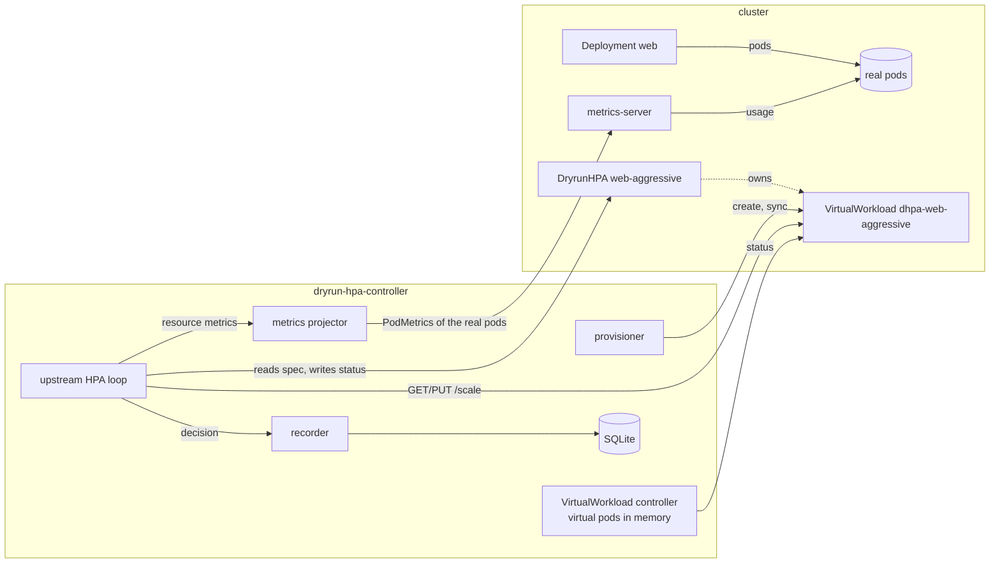

# dryrun-hpa

A standalone Kubernetes controller that runs the **upstream
HorizontalPodAutoscaler controller** (copied from Kubernetes v1.37.2 with
minimal patches) against a `DryrunHorizontalPodAutoscaler` (DHPA) resource.
A DHPA has exactly the spec of an `autoscaling/v2` HPA. It reads real
metrics of a real Deployment, but it never scales anything: it scales a
virtual copy of the Deployment and records every decision in a local SQLite
database for later analysis.

It serves two goals:

1. **Measure the cost of the HPA controller**: CPU and memory as a function of
   the number of HPAs and their parameters. See [test/perf](test/perf/README.md).
2. **Try HPA configurations safely**: aggressive targets, tight stabilization
   windows, custom policies, or what-if container requests. Run them next to
   production Deployments (and their real HPAs) with no way to affect them,
   then compare the decisions.

## How it works



The upstream controller code is unchanged except at its interfaces:

- The **HPA informer, lister and client** are backed by DHPAs; a transform
  rewrites `scaleTargetRef` to the DHPA's VirtualWorkload. Status writes go to
  the DHPA status.
- The **scale client** reads and writes `/scale` of the VirtualWorkload, never
  of the Deployment.
- The **pod lister** serves virtual pods for virtual selectors. Virtual pods
  are created when the VirtualWorkload is scaled up, become Ready after
  `pod-readiness-delay`, and report metrics after `metrics-delay` (the
  `Parallel` lifecycle profile: all new pods start at once, like a ReplicaSet).
- The **metrics client** projects real usage onto virtual pods: it sums the
  usage of the Deployment's ready, running pods per container (extrapolating
  ready pods that have no sample yet), and divides the total evenly among the
  virtual pods that are old enough to report metrics. The HPA sees "the same
  total load spread over a different number of pods". Container requests come
  from the newest running real pod (so sidecars and LimitRange defaults are
  included) unless overridden.
- A **reconcile observer** hook records each decision: every metric's current
  value and proposal, the recommendation before and after stabilization and
  behavior, the conditions, the real Deployment's replicas and, optionally,
  the desired replicas of a real HPA for the same Deployment.

Upstream events are emitted on the DHPA with a `DryRun` prefix
(`DryRunSuccessfulRescale`, `DryRunFailedGetResourceMetric`, …) so they can't
be confused with a real HPA's.

`hack/sync-upstream.sh` re-copies the upstream sources for a Kubernetes tag
and applies the small patch series in `hack/upstream-patches`;
`make verify-upstream` fails when `internal/upstream` differs from that.

## Quick start (kind)

```sh
make kind-up                                   # kind cluster "dryrun-hpa" with metrics-server
make kind-load IMG=localhost/dryrun-hpa:dev    # build the image and load it
make deploy IMG=localhost/dryrun-hpa:dev       # kustomize: config/default
```

or with Helm:

```sh
helm install dryrun-hpa charts/dryrun-hpa -n dryrun-hpa-system --create-namespace \
  --set image.repository=localhost/dryrun-hpa --set image.tag=dev
```

See `charts/dryrun-hpa/values.yaml` for the options (HPA flags, store,
simulation defaults, ServiceMonitor, dashboards, tracing). The decisions PVC
is kept when the release is uninstalled.

Point a DHPA at an existing Deployment (here `web`):

```yaml
apiVersion: dryrun-hpa.io/v1alpha1
kind: DryrunHorizontalPodAutoscaler
metadata:
  name: web-aggressive
spec:            # any autoscaling/v2 HorizontalPodAutoscalerSpec
  scaleTargetRef:
    apiVersion: apps/v1
    kind: Deployment
    name: web
  minReplicas: 2
  maxReplicas: 30
  metrics:
    - type: Resource
      resource:
        name: cpu
        target: {type: Utilization, averageUtilization: 50}
```

```console
$ kubectl get dhpa
NAME             REFERENCE   TARGETS   MINPODS   MAXPODS   REPLICAS   AGE
web-aggressive   web         83        2         30        6          5m
$ kubectl get vwl
NAME                  SOURCE   VIRTUAL   READY   REAL   AGE
dhpa-web-aggressive   web      6         6       3      5m
```

`REPLICAS`/`VIRTUAL` is what this configuration would run; `REAL` is what the
Deployment actually runs. `kubectl describe dhpa web-aggressive` shows the
usual HPA conditions and events. More examples are in `config/samples`.

### What a DHPA accepts

- The spec is validated like an HPA (CEL rules for the same constraints:
  `minReplicas ≤ maxReplicas`, metric sources matching their type, …).
- `scaleTargetRef` must be an `apps/v1` Deployment for now. Other kinds plug
  in through the `source.Adapter` interface in `internal/virtual/source`; the
  CEL rule and the registry are the only places that list kinds.
- Resource, ContainerResource and Pods metrics are projected from the real
  pods. Object and External metrics are passed through unchanged, since they
  don't depend on the pod count.

### Simulation annotations

| Annotation                           | Example                           | Effect                                                          |
|--------------------------------------|-----------------------------------|-----------------------------------------------------------------|
| `dryrun-hpa.io/pod-readiness-delay`  | `20s`                             | How long new virtual pods stay unready (flag default 15s)       |
| `dryrun-hpa.io/metrics-delay`        | `40s`                             | How long new virtual pods report no metrics (flag default 30s)  |
| `dryrun-hpa.io/request-overrides`    | `{"app":{"cpu":"1"}}`             | What-if requests per container; utilization is computed against them |

An invalid annotation is reported with a `DryRunInvalidAnnotation` warning
event and ignored.

## Analyzing decisions

Every reconcile produces one record. The `dryrun-hpactl` CLI reads them
through the export API (by default via the API server service proxy, so no
port-forward is needed) or directly from a copied database file (`--db`).

```sh
dryrun-hpactl report                          # per DHPA and configuration
dryrun-hpactl report -o json
dryrun-hpactl compare -n prod --name web-aggressive --since 24h
dryrun-hpactl specs -n prod                   # configurations a DHPA has had
dryrun-hpactl export -o csv -f decisions.csv --since 168h --only-rescales
dryrun-hpactl --db ./decisions.db report
```

- **report** summarizes each DHPA per configuration (`status.observedSpecHash`
  changes whenever the spec or annotations change, so experiments don't mix):
  decisions, scale-ups and scale-downs, flaps (direction reversals within five
  minutes), min/mean/max desired replicas, replica-hours against the real
  Deployment's replica-hours, the share of time at `maxReplicas`, and errors.
- **compare** reports how often the dry-run desired replicas match the real
  HPA (needs `--compare-real-hpa`) and the real Deployment: match ratio, mean
  and max absolute difference, and bias.
- **export** writes NDJSON, JSON or CSV. CSV flattens the first metrics into
  `metric<N>_{name,current,target,proposed_replicas}` columns
  (`--csv-metrics`).

The export API is plain HTTP on port 8082 (`export` service port):
`GET /api/v1/decisions`, `/api/v1/specs`, `/api/v1/summary` and
`/api/v1/compare`, filtered by `namespace`, `name`, `specHash`, `since`,
`until` (RFC 3339 or a duration such as `24h`), `onlyRescales`, `afterId`
and `limit`; decisions also take `format` (`ndjson`, `json`, `csv`).
Access through the service proxy is governed by RBAC on `services/proxy`.

Decisions are written asynchronously in batches. If the queue fills up, new
decisions are dropped (counted in `dryrun_hpa_decisions_total{store="dropped"}`)
rather than slowing down the HPA loop. Retention defaults to 7 days.

## Observability

- **Metrics** on `:8080/metrics`:
  - all upstream metrics (`horizontal_pod_autoscaler_controller_*`), plus
    client-go and workqueue metrics, exactly as kube-controller-manager
    exposes them;
  - `dryrun_hpa_*` for the dry-run layer: metrics API latency, projection
    time, provisioner and VirtualWorkload syncs, API writes, decisions, store
    write latency, batch size, queue length and size on disk, and the numbers
    of virtual workloads, virtual pods and cached objects;
  - with `--per-object-metrics`, per-DHPA series: desired, current, real and
    real-HPA replicas, each recommendation stage, metric values and targets,
    source usage and conditions. Their cardinality grows with the number of
    DHPAs.
- **Dashboards**: `config/prometheus` (or the chart's `serviceMonitor` and
  `dashboards` values) installs a ServiceMonitor and two Grafana dashboards:
  *cost* (resource use per object, reconcile and API latency, store) and
  *objects* (one DHPA's replicas against the real ones, recommendation stages,
  metrics). Regenerate them with `make generate`.
- **Profiling**: `--enable-pprof` serves `/debug/pprof` on the metrics port.
  Goroutines carry a `component` label (`hpa-loop`, `projection`, `recorder`,
  `store`, `provisioner`, `vw-controller`, `informers`, `http`) to split CPU
  between the upstream loop and the dry-run layer.
- **Tracing**: `--tracing-endpoint` exports OpenTelemetry spans over OTLP/gRPC
  for each reconcile and metrics query, sampled at `--tracing-sampling-ratio`.
- **Logging**: component-base structured logging (`--logging-format=json`,
  `-v`).

## Configuration

`dryrun-hpa-controller --help` lists everything. The upstream HPA flags have
the kube-controller-manager names and defaults
(`--horizontal-pod-autoscaler-sync-period`, `-tolerance`,
`-downscale-stabilization`, `-cpu-initialization-period`,
`-initial-readiness-delay`, `--concurrent-horizontal-pod-autoscaler-syncs`),
so a DHPA behaves like an HPA in a cluster with the same settings. Others:

| Flag                          | Default             | Meaning                                                    |
|-------------------------------|---------------------|------------------------------------------------------------|
| `--decision-store`            | `sqlite`            | `sqlite` or `none` (metrics only, for cost measurements)   |
| `--decision-db-path`          | `/data/decisions.db`| SQLite file; keep it on a persistent volume                |
| `--decision-retention`        | `168h`              | Age after which decisions are deleted; 0 keeps them        |
| `--pod-readiness-delay`       | `15s`               | Default delay before new virtual pods are Ready            |
| `--metrics-delay`             | `30s`               | Default delay before new virtual pods report metrics       |
| `--source-missing-pods`       | `extrapolate`       | How to treat ready real pods without a sample: `extrapolate` or `ignore` |
| `--compare-real-hpa`          | `false`             | Also record what real HPAs on the same Deployments want    |
| `--per-object-metrics`        | `false`             | Export per-DHPA Prometheus series                          |
| `--kube-api-qps`, `--kube-api-burst` | `20`, `30`   | Client rate limits                                         |
| `--leader-elect`              | `true`              | Lease-based leader election (only one replica can write the database) |

## Fidelity and limitations

- The upstream decision logic runs unchanged, but it sees **virtual pods**.
  Usage is spread evenly over them, so per-pod skew in the real Deployment is
  lost. The upstream handling of unready and missing pods applies to the
  virtual pods, whose readiness follows the simulation delays rather than the
  real pods' startup.
- The total load is assumed to be independent of the replica count. That
  holds for CPU-bound request load, but not for, say, per-pod memory
  overhead or queue-driven workloads.
- Only Deployments are supported as targets today.
- The cost measured for goal 1 includes the dry-run layer (projection,
  virtual workloads, decision store). The pprof labels and `dryrun_hpa_*`
  metrics separate it from the upstream loop; see
  [test/perf](test/perf/README.md).
- The SQLite store limits the controller to one active replica. The `Store`
  interface in `internal/store` is the extension point for another backend.

## Development

```
api/                    DryrunHorizontalPodAutoscaler and VirtualWorkload types
pkg/generated/          clientset, listers, informers (make generate)
internal/upstream/      upstream HPA controller (do not edit; see hack/sync-upstream.sh)
internal/adapter/       HPA, scale and pod adapters around the upstream controller
internal/virtual/       provisioner, VirtualWorkload controller, virtual pods, projection
internal/recorder/      decision hook → store
internal/store/         Store interface, SQLite, async writer
internal/analysis/      summaries, comparisons, encoders
internal/exportapi/     HTTP export API
internal/observability/ metrics, pprof labels, tracing
cmd/                    controller, dryrun-hpactl, loadgen, fake-metrics-server
config/                 kustomize (default, e2e, perf, prometheus, samples)
charts/dryrun-hpa/      Helm chart (CRDs, RBAC and dashboards copied by make generate)
test/e2e/, test/perf/   kind end-to-end tests and the cost harness
```

```sh
make build            # bin/{dryrun-hpa-controller,dryrun-hpactl,loadgen,fake-metrics-server}
make test             # unit tests, including the ported upstream tests
make lint
make generate         # codegen, CRDs, RBAC, dashboards, chart files
make sync-upstream    # re-copy upstream and apply hack/upstream-patches
make deploy-e2e e2e   # see test/e2e/README.md
make perf-setup perf  # see test/perf/README.md
```

Never run `gofmt` on `internal/upstream`; `make fmt` skips it so that
`make verify-upstream` stays clean.

The Go module path is `github.com/fedosin/dryrun-hpa`. Change it with
`go mod edit -module` and a search-and-replace if the project lives elsewhere.
